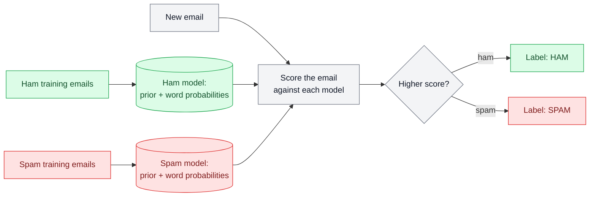
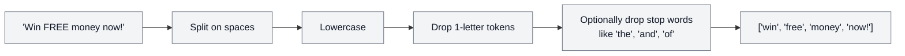
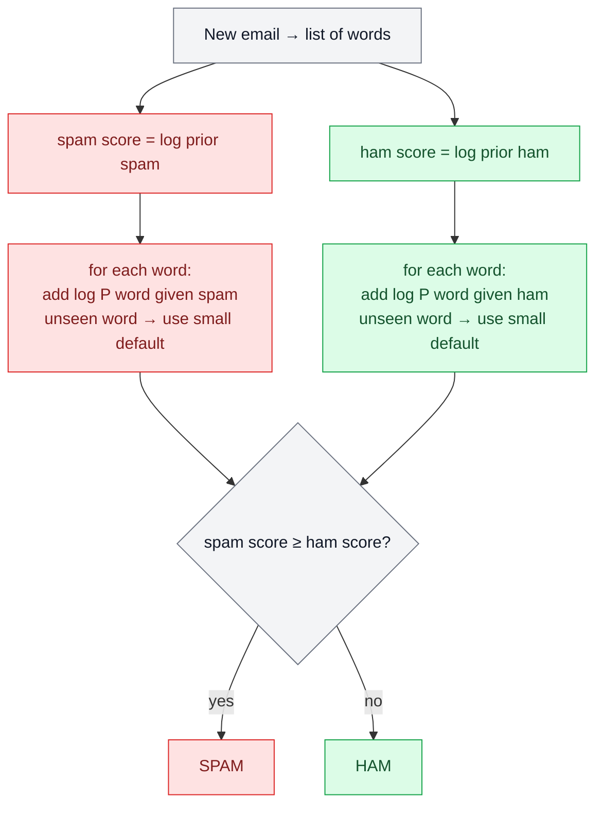

# How the Naive Bayes Spam Classifier Works

## The idea in one paragraph

Spam emails use certain words a lot ("free", "prize", "click"). Normal emails (ham) use other words ("meeting", "report"). To judge a new email, we ask: **"Does this email's wording look more like the spam we've seen, or more like the ham we've seen?"** Whichever class fits better wins.

It's called *naive* because it pretends every word is independent of the others. That isn't true in real language, but it works surprisingly well.

## Big picture

> **Colour key:** 🟩 green = ham (legitimate) · 🟥 red = spam · ⬜ grey = neutral steps shared by both. Colour is only used where it tells you which class something belongs to.

## Step 1 – Clean the text

Stop words are very common words that say little about spam vs. ham. The program runs twice: once removing them, once keeping them, so you can compare.

## Step 2 – Training (learn from examples)

**a) Priors – how common is each class?**

> prior(spam) = spam training emails ÷ all training emails
> prior(ham) = ham training emails ÷ all training emails

**b) Word probabilities – how likely is each word in each class?**

Paste all spam emails together and count each word; do the same for ham.

> P(word | class) = (times the word appears in the class + 1) ÷ (total words in the class + vocabulary size)

The **+1** is called *add-one (Laplace) smoothing*. Without it, a word never seen in spam would get probability 0 and wipe out the whole score. With it, unseen words just get a small non-zero probability.

Tiny example:

| Word | Count in spam | Count in ham |
|---|---|---|
| free | 5 | 0 |
| meeting | 0 | 4 |

"free" is far more likely in spam, "meeting" far more likely in ham.

## Step 3 – Classifying a new email

Start each class with its prior, then add up evidence from every word:

**Why logs?** Multiplying hundreds of tiny probabilities (like 0.0003 × 0.0001 × …) gets so small a computer rounds it to zero. Adding their logarithms gives the same ranking with no precision problem. The code uses base-10 logs.

Worked example for the email "free prize meeting":

| | prior | free | prize | meeting | total (log) |
|---|---|---|---|---|---|
| spam | high | high | high | tiny | **larger** |
| ham | lower | tiny | tiny | high | smaller |

Spam wins → labelled **SPAM**.

## Step 4 – Measuring accuracy

Each test email's true label is its folder (ham test folder = truly ham). The program counts correct vs. wrong per class:

> accuracy = (ham correct + spam correct) ÷ all test emails × 100

## How it maps to the code

| Concept | Function in `src/naive_bayes.py` |
|---|---|
| Clean / tokenise text | `Test` |
| Read a folder of emails | `folderText`, `fnPrior` |
| Word probabilities (smoothed) | `spamConditionalProbablity` |
| Train one class | `Train` |
| Train both + priors | `TrainMultinomail` |
| Score an email | `_scores` |
| Classify ham / spam test folders | `hamTest`, `spamTest` |
| Run everything, print accuracy | `mainfn` |
